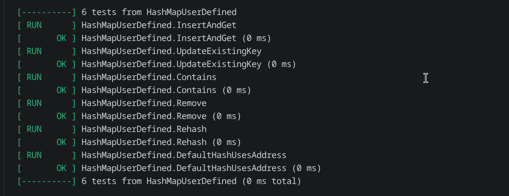

# Build Log 8

## Date:Jul 16

### Session - 1

#### Work Completed

- I first integrated Valgrind into the project through CMake so memory checking could be executed directly from the build system. After running the entire Google Test suite under Valgrind, all 240 unit tests passed successfully with zero memory leaks, zero invalid memory accesses, and every allocation correctly freed.

-After this I implemented one more test file for HashMap HMuserdef_test.cpp I designed a new set of unit tests using a custom Employee class to verify that the templated HashMap works correctly with user-defined objects. While writing these tests, I reviewed how generic containers depend on both operator== and a custom hash functor to correctly compare and hash user-defined keys.

I also explored the behavior of my DefaultHash implementation for unsupported types. Since it hashes objects using their memory addresses, I wrote an additional test to verify that the same object instance can be found correctly when the default hasher is used.

## Session - 2

#### Work Completed

- I learned the complete crawling workflow, from starting with a seed URL, fetching HTML, extracting links, storing pages, and continuing until the Frontier becomes empty or predefined limits such as maximum depth or maximum pages are reached.

I also learned how search engines use crawlers to build an index in advance, allowing user queries to be answered quickly without searching the live web.